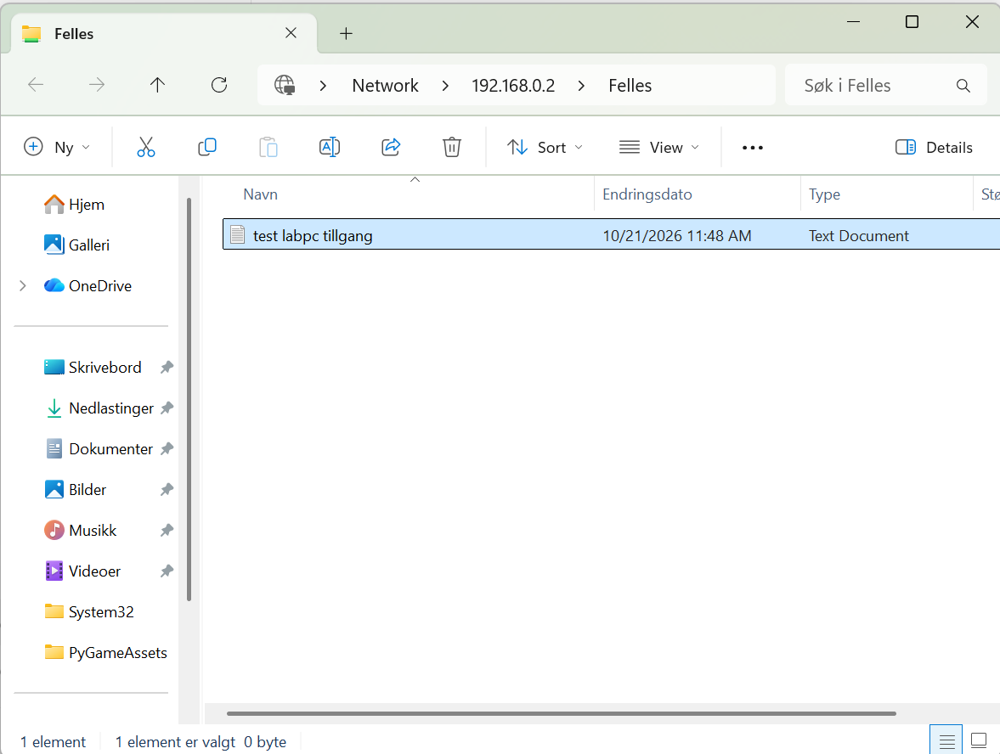

**Fag:** IT / nettverk  
**Elev:** Thomas Lauritzen 
**Skole:** Kuben VGs
**Dato:** 30/10/2026  
**Status:** Ferdig

## 1. Innledning og oppdragsbeskrivelse

Formålet med dette prosjektet er å bygge, undersøke og dokumentere et fysisk nettverk og deretter bruke de samme nettverksprinsippene til å bygge et større bedriftsnettverk i Cisco Packet Tracer.

Prosjektet består av to hoveddeler. I den første delen skal jeg koble sammen en ruter, en switch, en Windows Server og en bærbar Windows-klient. Jeg skal konfigurere IP-adresser, teste kommunikasjon, sette opp DHCP og undersøke en tjeneste på serveren.

I den andre delen skal jeg bygge et simulert bedriftsnettverk for FjordTek AS. Dette nettverket skal ha flere LAN, to rutere, routing mellom nettverkene og tjenestene DHCP, DNS og HTTP.

Jeg skal dokumentere planlegging, konfigurasjon, testing og feilsøking. Målet er å forstå hvordan fysisk tilkobling, IP-adresser, routing, porter og nettverkstjenester fungerer sammen.

### Avvik fra opprinnelig plan

Den opprinnelige planen var å bruke Windows Server som en standalone-server uten Active Directory eller domenetjenester. Under arbeidet oppdaget jeg at serveren allerede var konfigurert som domenekontroller for domenet `firma.local`.

Jeg valgte å beholde det eksisterende miljøet og bruke den delte mappen `Felles` til å teste kommunikasjon og filtilgang fra klient-PC-en. Under feilsøkingen undersøkte jeg også tilgangsrettigheter og en eksisterende Active Directory-sikkerhetsgruppe, `GG-informasjon-read`.

Dette innebærer at den fysiske delen av prosjektet avviker fra den opprinnelige planen. Jeg dokumenterer derfor den faktiske konfigurasjonen og resultatene fra testene, i stedet for å beskrive serveren som en standalone-server.

En videre forbedring vil være å begrense tilgangsrettighetene til relevante brukere eller grupper og kontrollere at de samsvarer med kravene til prosjektet.

## 2. Kravspesifikasjon

Kravspesifikasjonen beskriver hva nettverkene skal kunne gjøre når prosjektet er ferdig.

| ID | Krav | Testmetode |
|---|---|---|
| K01 | SERVER01 og CLIENT01 skal kommunisere i det fysiske labnettet. | Ping mellom klient og server. |
| K02 | SERVER01 skal ha fast IP-adresse. | Kontrollere IP-konfigurasjonen. |
| K03 | CLIENT01 skal motta nettverksinnstillinger automatisk fra ruteren via DHCP | Kontrollere med `ipconfig /all`. |
| K04 | CLIENT01 skal kunne bruke en tjeneste på SERVER01. | Åpne en delt mappe og opprette en testfil. |
| K05 | Packet Tracer-nettverket skal ha flere LAN og routing mellom dem. | Teste kommunikasjon mellom forskjellige LAN. |
| K06 | Packet Tracer-klientene skal få riktige nettverksinnstillinger og kunne bruke DNS og HTTP. | Testresultat: DHCP er konfigurert for klientnettverkene. DNS-navnet intranett.fjordtek.local peker til serveren 192.168.30.10, og HTTP-tjenesten er aktivert. Klientene ble testet ved å åpne intranettsiden med DNS-navnet. Testene er dokumentert med skjermbilder i seksjon 8.3. |
| K07 | Nettverksløsningene skal testes og dokumenteres. | Dokumentere tester og resultater fra begge delene. |
| K08 | Trafikken mellom CLIENT01 og SERVER01 skal undersøkes i Wireshark. | Fange opp ICMP- og TCP-trafikk og undersøke kilde- og mål-IP. |

Kravene skal kontrolleres på nytt i akseptansetesten mot slutten av prosjektet.

## 3. Fysisk nettverk – topologi og utstyr

### 3.1 Utstyr

Det fysiske nettverket består av:

- En TP-Link-ruter
- En switch (SW1)
- SERVER01 – Windows Server 2025 Standard
- CLIENT01 – bærbar Windows-klient

### 3.2 Faktisk topologi

SERVER01 og CLIENT01 er koblet til SW1. SW1 er koblet videre til TP-Link-ruteren. Ruteren fungerer som standard gateway for enhetene i det fysiske nettverket.

```text
SERVER01 ──┐
           ├── SW1 ─── TP-Link-ruter
CLIENT01 ──┘
```

### 3.3 Fysisk nettverkskonfigurasjon

Det fysiske nettverket bruker adresseområdet `192.168.0.0/24`.

- **Ruter:** `192.168.0.1`
- **SERVER01:** `192.168.0.2` – statisk IP-adresse
- **CLIENT01:** `192.168.0.101` – mottar IP-adresse via DHCP

Klienten ble testet mot både ruteren og serveren. Begge ping-testene ga fire svar av fire, uten pakketap. Resultatene er dokumentert i seksjon 4.

### 3.4 Avvik fra planlagt topologi

Den opprinnelige planen beskrev en egen ruter (R1) med adresseområdet `192.168.50.0/24`. I den faktiske løsningen ble den eksisterende TP-Link-ruteren og adresseområdet `192.168.0.0/24` beholdt.

Den faktiske konfigurasjonen dokumenteres separat fra den opprinnelige planen. Packet Tracer-nettverket beskrives i seksjon 7.

## 4. Adresseplan og konfigurasjon

### 4.1 Opprinnelig planlagt adresseplan for fysisk nettverk

| Enhet | IP-adresse | Subnettmaske | Gateway | Tildeling |
|---|---|---|---|---|
| R1 | 192.168.50.1 | 255.255.255.0 | Ikke aktuelt | Statisk |
| SERVER01 | 192.168.50.10 | 255.255.255.0 | 192.168.50.1 | Statisk |
| CLIENT01 | 192.168.50.20 i første test | 255.255.255.0 | 192.168.50.1 | Statisk først, deretter DHCP |

DHCP-området skal konfigureres på R1. Adresser som brukes av ruteren og serveren, skal unntas fra DHCP-tildeling.


### 4.2 Faktisk konfigurasjon av fysisk nettverk

Det fysiske nettverket bruker foreløpig TP-Link-ruteren og adresseområdet `192.168.0.0/24`.

| Enhet | IPv4-adresse | Nettverksmaske | Gateway | IP-tildeling |
|---|---|---|---|---|
| Ruter | `192.168.0.1` | `255.255.255.0` | Ikke aktuelt | Eksisterende konfigurasjon |
| SERVER01 | `192.168.0.2` | `255.255.255.0` | `192.168.0.1` | Statisk |
| CLIENT01 | `192.168.0.101` | `255.255.255.0` | `192.168.0.1` | DHCP |

På SERVER01 viste `ipconfig /all` at DHCP er deaktivert. Dette stemmer med at serveren bruker en statisk IP-adresse.

På CLIENT01 ble IPv4-innstillingene endret til automatisk tildeling av IP-adresse og DNS-serveradresse. Etterpå viste `ipconfig /all` følgende:

- DHCP aktivert: Ja
- DHCP-server: `192.168.0.1`
- IPv4-adresse: `192.168.0.101`
- Standard gateway: `192.168.0.1`

Dette bekrefter at klienten mottar nettverksinnstillinger automatisk fra TP-Link-ruteren. At klienten beholdt samme IPv4-adresse, betyr ikke at den fortsatt er statisk konfigurert.

**Avvik fra planlagt adresseplan:** Det fysiske nettverket bruker foreløpig `192.168.0.0/24`, mens den opprinnelige planen bruker `192.168.50.0/24`. Den faktiske konfigurasjonen dokumenteres separat fra den planlagte adressestrukturen. Den fysiske konfigurasjonen beholdes foreløpig uendret for å unngå å forstyrre det eksisterende nettverket. Den planlagte adressestrukturen brukes som utgangspunkt dersom det fysiske nettverket senere skal konfigureres etter planen. Packet Tracer-løsningen dokumenteres separat.

### 4.3 Testresultater for fysisk nettverk

Ping-testene ble utført fra CLIENT01.

| Test | Resultat | Status |
|---|---|---|
| Ping til gateway `192.168.0.1` | 4 sendt, 4 mottatt, 0 % pakketap | Bestått |
| Ping til SERVER01 `192.168.0.2` | 4 sendt, 4 mottatt, 0 % pakketap | Bestått |

Begge testene bekreftet at CLIENT01 hadde kontakt med gatewayen og serveren.


## 5. Server og tjenester

### 5.1 Fysisk nettverk – Windows Server

SERVER01 kjører Windows Server 2025 Standard og er konfigurert som domenekontroller for domenet `firma.local`. Dette avviker fra den opprinnelige planen, der serveren skulle være en standalone-server uten Active Directory.

SERVER01 bruker statisk IP-adresse `192.168.0.2/24`, med standard gateway `192.168.0.1`. DHCP er deaktivert på serveren.

### 5.2 Fildeling

På SERVER01 bruker jeg den eksisterende mappen `D:\data\INFORMASJON`, som er delt med nettverksnavnet `Felles`. Klient-PC-en åpner delingen via:

`\\192.168.0.2\Felles`

Jeg testet fildelingen fra CLIENT01 ved å åpne mappen og forsøke å opprette et tekstdokument. Først fikk jeg en tillatelsesfeil. Under feilsøkingen endret jeg tilgangsrettighetene, og etter endringen kunne klienten opprette et dokument.

Testen viser at fildelingen fungerte med de endrede rettighetene. Tilgangene må sikres videre ved å gi bare relevante brukere eller sikkerhetsgrupper nødvendige rettigheter.




### 5.3 Packet Tracer – DNS og HTTP

I Packet Tracer bruker serveren IP-adressen `192.168.30.10/24` og standard gateway `192.168.30.1`.

DNS-tjenesten er konfigurert med navnet:

`intranett.fjordtek.local`

DNS-navnet peker til `192.168.30.10`. HTTP-tjenesten er aktivert på serveren. DNS- og HTTP-trafikken er undersøkt i Simulation Mode og dokumentert med skjermbilder i seksjon 8.

Det fysiske nettverket og Packet Tracer-nettverket er separate oppsett. De bruker forskjellige IP-adresser og skal derfor dokumenteres hver for seg.

## 6. Nmap, porter og Wireshark


### 6.1 Nmap

Jeg brukte Nmap fra CLIENT01 for å undersøke hvilke TCP-porter og tjenester som var tilgjengelige på SERVER01 (`192.168.0.2`). Jeg kjørte kommandoen:

```cmd
nmap -sV 192.168.0.2
```

Nmap rapporterte at verten var tilgjengelig, og identifiserte flere åpne TCP-porter.

| Port | Tjeneste | Observasjon |
|---|---|---|
| 53/tcp | DNS | DNS-tjeneste ble identifisert. |
| 88/tcp | Kerberos | Brukes til autentisering i Active Directory. |
| 389/tcp | LDAP | Nmap identifiserte LDAP knyttet til domenet `firma.local`. |
| 445/tcp | Microsoft-DS | Relevant for Windows-fil- og delingstjenester. |
| 5985/tcp | HTTPAPI | Nmap identifiserte Microsoft HTTPAPI, ofte knyttet til WinRM. |


Nmap identifiserte også vertsnavnet `DC01` og domenet `firma.local`. Dette støtter observasjonen om at serveren allerede er konfigurert som domenekontroller.

**Resultat:** Nmap-testen er gjennomført. Flere TCP-porter ble rapportert som åpne. 987 andre TCP-porter ble rapportert som filtrerte, det vil si at Nmap ikke mottok svar som gjorde det mulig å fastslå tilstanden deres.

**Vurdering:** Port 445 er spesielt relevant for prosjektet fordi klienten bruker den delte mappen `Felles`. Skanningen viser hvilke tjenester som er tilgjengelige fra klienten, men beviser ikke alene at tjenestene er sikkert konfigurert.

Dokumentasjon: Skjermbildet under viser resultatet av Nmap-skanningen av SERVER01, inkludert identifiserte åpne TCP-porter og tjenester.


### 6.2 Wireshark – ICMP

Jeg startet en pakkefangst i Wireshark på Ethernet-grensesnittet og utførte en ping-test fra CLIENT01 til SERVER01 (`192.168.0.2`). Med visningsfilteret `icmp` fant jeg både Echo (ping) request og Echo (ping) reply.

- **ICMP request:** Source `192.168.0.101`, destination `192.168.0.2`.
- **ICMP reply:** Source `192.168.0.2`, destination `192.168.0.101`.
- **Lengde:** Wireshark viste 74 byte for pakken jeg undersøkte.

Dette viser at klienten sendte en ICMP-forespørsel til serveren, og at serveren sendte et svar tilbake. Resultatet samsvarer med ping-testen, som fikk svar fra serveren.


Dokumentasjon: Skjermbildet under viser ICMP Echo Request fra CLIENT01 til SERVER01 og ICMP Echo Reply tilbake til klienten.


#### TCP og SMB-fildeling

Jeg startet en pakkefangst i Wireshark mens jeg åpnet den delte mappen `\\192.168.0.2\Felles` fra CLIENT01. Jeg brukte visningsfilteret `tcp && ip.addr == 192.168.0.2`.

Jeg observerte følgende TCP-pakker:

1. **SYN:** `192.168.0.101:53940` til `192.168.0.2:445`.
2. **SYN, ACK:** `192.168.0.2:445` til `192.168.0.101:53940`.
3. **ACK:** `192.168.0.101:53940` til `192.168.0.2:445`.

Dette er TCP three-way handshake. Port 445 brukes vanligvis til SMB-fildeling i Windows. Pakkene viser at klienten opprettet en TCP-forbindelse til serveren på denne porten.

Sammen med den vellykkede testen der jeg åpnet delingen og opprettet en testfil, støtter dette at nettverksforbindelsen og fildelingen fungerer.


Skjermbildet viser TCP three-way handshake mellom CLIENT01 og SERVER01 på port 445. Dette dokumenterer opprettelsen av TCP-forbindelsen som brukes ved SMB-fildeling.


## 7. Packet Tracer – topologi og routing

Bedriftsnettverket skal representere FjordTek AS, med hovedkontor og salgsavdeling.

Nettverket skal bestå av minst to rutere, fire switcher, tre klientnett og et eget servernett.
### Nettverkstopologi


### 7.1 Ping mellom PC-ADMIN og PC-SALES

Ping-testen bekreftet at PC-ADMIN kunne kommunisere med PC-SALES på tvers av nettverkene.


### 7.2 Traceroute fra PC-ADMIN

Traceroute viste veien gjennom R1 og R2 til servernettverket.


### 7.3 Planlagt adresseplan

| Nettverk | Nettadresse | Planlagt gateway |
|---|---|---|
| Administrasjon | 192.168.10.0/24 | 192.168.10.1 |
| Support | 192.168.20.0/24 | 192.168.20.1 |
| Servere | 192.168.30.0/24 | 192.168.30.1 |
| Salg | 192.168.40.0/24 | 192.168.40.1 |
| Forbindelse R1–R2 | 10.0.0.0/30 | Fastsettes for hvert grensesnitt |

R1 skal håndtere nettverkene ved hovedkontoret, mens R2 skal håndtere salgsnettverket.

Det skal konfigureres statiske ruter mellom ruterne, slik at klienter i de forskjellige LAN-ene kan kommunisere.

DHCP skal gi klientene nettverksinnstillinger. Serveren skal levere DNS og HTTP.

### 7.4 Faktisk topologi og konfigurasjon

Packet Tracer-nettverket er bygget med to rutere, fire switcher, tre klientnett og ett eget servernett.

**Tilkoblinger**

- R1 G0/0 → SW1 – Administrasjon
- R1 G0/1 → SW2 – Support
- R1 G0/2 → R2 G0/0 – forbindelse mellom ruterne
- R2 G0/1 → SW3 – Servernett
- R2 G0/2 → SW4 – Salg

**IP-adresser på rutere**

| Ruter | Grensesnitt | IP-adresse |
|---|---|---|
| R1 | G0/0 | 192.168.10.1/24 |
| R1 | G0/1 | 192.168.20.1/24 |
| R1 | G0/2 | 10.0.0.1/30 |
| R2 | G0/0 | 10.0.0.2/30 |
| R2 | G0/1 | 192.168.30.1/24 |
| R2 | G0/2 | 192.168.40.1/24 |

Det er konfigurert statiske ruter mellom R1 og R2 for kommunikasjon mellom nettverkene.

DHCP er konfigurert for klientnettverkene. Serveren bruker IP-adressen `192.168.30.10/24`, med gateway `192.168.30.1`, og leverer DNS- og HTTP-tjenester.


## 8. Simulation Mode

Simulation Mode ble brukt til å undersøke hvordan pakker beveger seg gjennom nettverket.

### 8.1 ARP og ICMP

Jeg undersøkte nettverkstrafikk mellom klienter og observerte hvordan ARP brukes til å finne MAC-adressen til en enhet på det lokale nettverket. Jeg undersøkte også ICMP-trafikk som brukes ved ping-testing.

### 8.2 Kommunikasjon mellom Administrasjon og Salg

Jeg testet kommunikasjon mellom klienter i forskjellige LAN. Traceroute fra PC-ADMIN til serveren viste følgende vei:

1. R1: `192.168.10.1`
2. R2: `10.0.0.2`
3. Server: `192.168.30.10`

Dette viser at trafikken gikk gjennom begge ruterne før den nådde serveren.


### 8.3 DNS og HTTP

Jeg konfigurerte DNS-navnet `intranett.fjordtek.local` til å peke på serveren `192.168.30.10`. HTTP-tjenesten ble aktivert på serveren. Jeg undersøkte DNS- og HTTP-trafikken i Simulation Mode.


### DNS- og HTTP-test

DNS-navnet `intranett.fjordtek.local` ble brukt for å åpne intranettsiden fra en klient. I Simulation Mode ble DNS- og HTTP-trafikken undersøkt.


### Test av intranettside fra klient-PC

For å kontrollere at DNS og HTTP fungerer sammen, åpnet jeg nettleseren på en klient-PC i Packet Tracer og skrev inn `intranett.fjordtek.local`.

Nettsiden ble åpnet fra klienten. Dette viser at klienten klarer å slå opp DNS-navnet og få tilgang til webserveren via HTTP.


## 9. Feilsøking

### Feilsøking: Skrivetilgang til delt mappe

- **Symptom:** Klient-PC-en kunne åpne den delte mappen `Felles`, men fikk ikke tillatelse til å opprette et tekstdokument.
- **Hypotese:** Problemet skyldtes manglende tilgangsrettigheter på mappen eller delingen.
- **Test:** Jeg undersøkte delingsrettighetene og sikkerhetsrettighetene på den fysiske `INFORMASJON`-mappen på Windows Server.
- **Funn:** Klienten kunne lese mappen, men hadde ikke tilstrekkelig skrivetilgang.
- **Løsning:** Jeg utvidet rettighetene til alle under feilsøkingen. Etter endringen kunne klienten opprette et tekstdokument i den delte mappen.
- **Videre forbedring:** Jeg bør begrense rettighetene til relevante domenebrukere eller sikkerhetsgrupper og teste på nytt at riktig bruker har nødvendig tilgang.

## 10. Akseptansetest

Akseptansetesten kontrollerer om kravene i kravspesifikasjonen er oppfylt. Resultatene fra det fysiske nettverket og Packet Tracer dokumenteres separat.

| **Krav** | **Test** | **Forventet resultat** | **Faktisk resultat** |
|---|---|---|---|
| K01 | Ping mellom CLIENT01 og SERVER01 | Maskinene kommuniserer | Bestått: 4 svar av 4, 0 % pakketap. |
| K02 | Kontroller SERVER01s IP-adresse | Fast adresse er konfigurert | Bestått: `192.168.0.2`, statisk IP og DHCP deaktivert. |
| K03 | Kontroller DHCP på CLIENT01 | Klienten får gyldig IP og gateway | Bestått: DHCP aktivert, klientadresse `192.168.0.101`, gateway `192.168.0.1`. |
| K04 | Åpne Felles og opprette testfil | Klienten kan opprette en fil på serveren | Bestått med gjeldende rettigheter. Rettighetene må begrenses til relevante brukere eller grupper. |
| K05 | Test kommunikasjon mellom Packet Tracer-nettverk | Routing gir kommunikasjon mellom nettverkene | Bestått: Ping til serveren fra Administrasjon, Support og Salg fungerte. Ping mellom PC-ADMIN og PC-SALES er også dokumentert. |
| K06 | Test DHCP, DNS og HTTP i Packet Tracer | Klientene får nettverksinnstillinger, og intranettet kan åpnes med DNS-navn | DHCP er konfigurert. DNS-navnet `intranett.fjordtek.local` peker til `192.168.30.10`, og HTTP er aktivert. |
| K07 | Dokumenter testresultatene | Tester og observasjoner er dokumentert | Dokumentert i README med testresultater og skjermbilder. |
| K08 | Fang opp ICMP- og TCP-trafikk i Wireshark | Relevant trafikk kan identifiseres | Bestått: ICMP request/reply og TCP three-way handshake mot port 445 ble observert. |

**Merknad:** Resultatene gjelder testene som er dokumentert i prosjektet. Fildelingstesten fungerte etter at rettighetene ble utvidet, men tilgangene må sikres bedre før løsningen regnes som ferdig.

## 11. Oppsummering og refleksjon

### 11.1 Oppsummering

I dette prosjektet har jeg arbeidet med både et fysisk nettverk og et simulert bedriftsnettverk i Cisco Packet Tracer. Målet har vært å forstå hvordan fysisk tilkobling, IP-adresser, DHCP, gateway, routing og nettverkstjenester fungerer sammen.

I det fysiske nettverket brukte jeg en TP-Link-ruter, en switch, en Windows Server og en klient-PC. Jeg dokumenterte IP-konfigurasjonen og testet kommunikasjonen med ping. Klienten fikk nettverksinnstillinger via DHCP, og ping-testene mot ruteren og serveren ga svar uten pakketap.

Jeg undersøkte også tilgjengelige porter og tjenester på serveren med Nmap. Med Wireshark undersøkte jeg ICMP-trafikk og TCP-forbindelsen som ble opprettet ved bruk av SMB-fildeling.

I Packet Tracer bygget jeg et bedriftsnettverk med to rutere, fire switcher, flere LAN og et eget servernett. Jeg konfigurerte statiske ruter og DHCP, og testet kommunikasjon mellom nettverkene. Jeg undersøkte også trafikken i Simulation Mode for å få bedre forståelse av hvordan pakker beveger seg gjennom nettverket.

### 11.2 Utfordringer og feilsøking

En utfordring i det fysiske nettverket var at klienten først kunne åpne den delte mappen, men ikke opprette et tekstdokument. Jeg undersøkte tilgangsrettighetene og endret dem under feilsøkingen. Etter endringen fungerte skrivetilgangen.

Denne feilen viste meg at det ikke er nok at nettverksforbindelsen fungerer. Tilgangsrettighetene på serveren må også være riktig konfigurert. I en ferdig løsning bør rettighetene begrenses til relevante brukere eller sikkerhetsgrupper.

Jeg oppdaget også at den faktiske konfigurasjonen av det fysiske nettverket avvek fra den opprinnelige planen. Jeg beholdt den eksisterende TP-Link-ruteren og dokumenterte det faktiske adresseområdet separat fra den planlagte adressestrukturen.

### 11.3 Hva jeg har lært

Gjennom prosjektet har jeg fått bedre forståelse av hvordan IP-adresser, subnettmasker og standard gateway brukes for kommunikasjon i et nettverk. Jeg har også lært mer om hvordan DHCP tildeler nettverksinnstillinger automatisk, og hvordan rutere videresender trafikk mellom forskjellige nettverk.

Nmap ga meg erfaring med å undersøke åpne porter og tilgjengelige tjenester. Wireshark gjorde det mulig å se nettverkstrafikken direkte, blant annet ICMP request/reply og TCP three-way handshake. Dette gjorde sammenhengen mellom nettverkskommunikasjon og tjenestene på serveren lettere å forstå.

Packet Tracer ga meg mulighet til å bygge og teste en større nettverksstruktur uten å måtte koble sammen alt det fysiske utstyret.

### 11.4 Forbedringer

Hvis jeg skulle videreutvikle prosjektet, ville jeg først sikret fildelingen ved å gi bare relevante brukere og grupper nødvendige rettigheter. Jeg ville deretter testet at riktige brukere kan lese og skrive, mens andre brukere ikke får unødvendig tilgang.

Jeg ville også kontrollert at alle testresultater er dokumentert med tydelige skjermbilder, og at README-filen, Packet Tracer-filen og prosjektbrettet er oppdatert. Til slutt ville jeg gått gjennom kravspesifikasjonen punkt for punkt for å sikre at alle krav er testet og dokumentert.

## 12. Prosjektstyring og filer

### 12.1 Prosjektstyring

Prosjektet organiseres og følges opp i GitHub Projects. Prosjektbrettet viser oppgavene og fremdriften gjennom statusene Todo, In progress og Done.

- **Prosjektbrett:** https://github.com/users/y0trexBP/projects/1

### 12.2 Mappestruktur

Prosjektet er organisert med en egen mappe for Packet Tracer-filen og en mappe for skjermbilder fra testene.

```text
fjordtek-nettverksprosjekt/
├── README.md
├── packet-tracer/
│   ├── cisco packet tracer oppgave.pkt
│   └── README.md
└── images/
    ├── cisco dns&http test.png
    ├── cisco dns&http test2.png
    ├── packet tracer nett.png
    ├── ping admin sales.png
    ├── tracing csico oppgave.png
    ├── klient-pc-tillgang.png
    ├── oppgave nmap.png
    ├── wireshark oppgave.png
    ├── cisco nettside oppgave.png
    └── wireshark tcp 6.2.png
```

Bildene i `images/` dokumenterer nettverkstopologien, ping- og traceroute-tester, DNS- og HTTP-tester, tilgang til fildeling, Nmap-skanning og Wireshark-analyse av ICMP- og TCP-trafikk.
